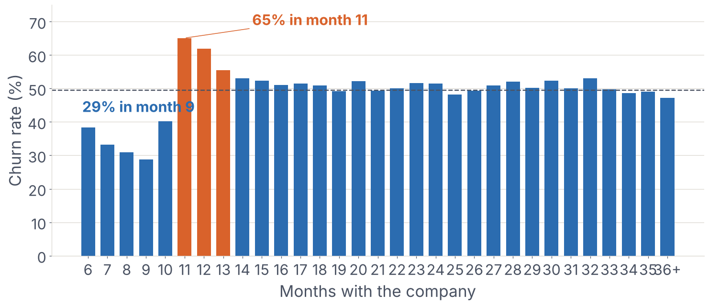
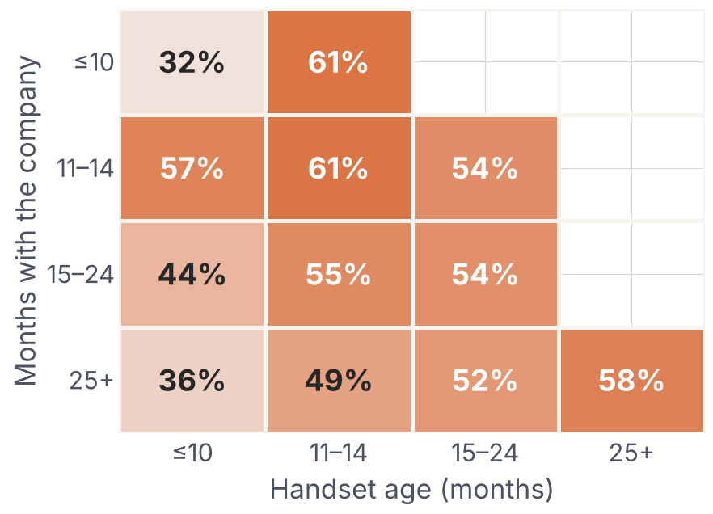
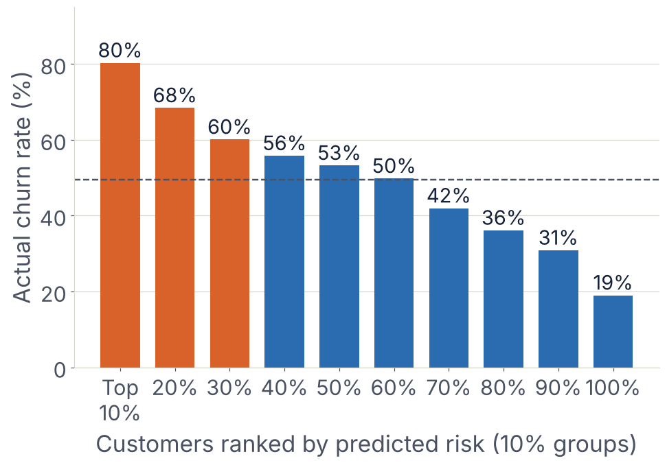
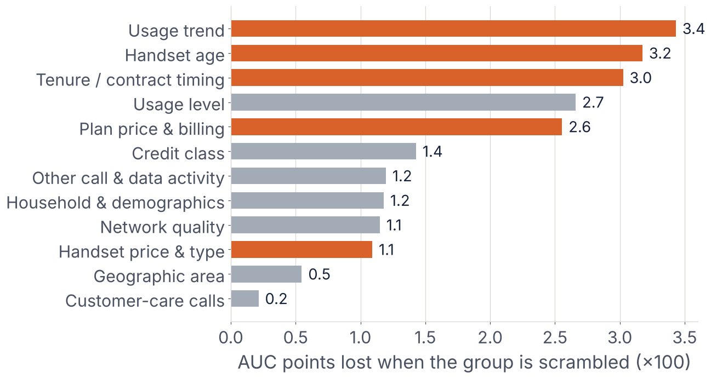
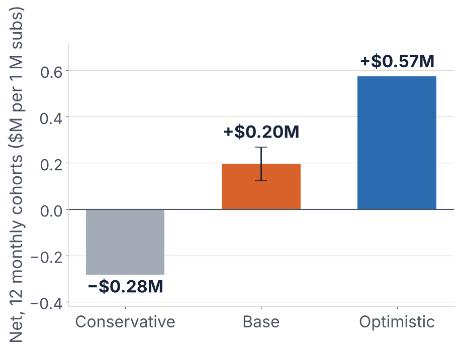

# Smart Upgrade: Predicting and Reducing Telecom Customer Churn


A data-driven business proposal for **Company A**, an anonymous mobile operator with 100,000 customers and no in-house machine learning team. The project goes from exploratory analysis to a churn-prediction model to a costed, testable retention programme.

> Final Assignment, **GCI World 2026 September** (Matsuo-Iwasawa Lab, The University of Tokyo).

---

## The business question

> *Which customers are likely to leave in the next one to two months, so the company can make them the right offer before they decide?*

## Key results

| | |
|---|---|
| **Main pattern** | Churn rises sharply around **month 11** of tenure (65% vs 29% in month 9, sample rates) and for phones older than **~10 months** |
| **Best model** | **LightGBM**, chosen on 5-fold cross-validation (0.698 ± 0.002) |
| **Test ROC-AUC** | **0.699** on 30,000 unseen customers (Random Forest 0.682, Logistic Regression 0.654, baseline 0.500) |
| **Ranking power** | Riskiest 10% churn at **80%** in the sample; the riskiest 30% hold **42%** of all churners |
| **Proposal** | *Smart Upgrade*: offer the riskiest ~0.7% each month a subsidised phone upgrade with a 12-month renewal |
| **Expected value** | Base case **+$0.20M** per 1M subscribers over 12 monthly campaigns (range −$0.28M to +$0.57M); the same offer sent to everyone: **−$48.7M** |

The financial figures are **scenario estimates under stated assumptions**, not guaranteed returns. The proposal starts with a randomised pilot.

<p align="center">
  
</p>

<p align="center">
  
  
</p>

---

## Approach

1. **Data quality check:** one-to-one merge of two tables (100,000 × 100); missing-value analysis (missing usage records churn at 69–76%); documented handling of negative and near-duplicate columns.
2. **Exploratory analysis:** churn by tenure, handset age and price, usage trend, service quality and customer-care contact. All findings are reported as associations, not causes.
3. **Problem definition:** binary classification with a risk score; ROC-AUC as the main metric, because the retention team needs a *ranked* list.
4. **Feature engineering:** 8 features built from the analysis (handset-age and tenure windows, usage-change ratio, missing-data flags), worth +0.004 AUC in cross-validation. Ethnicity is excluded on purpose.
5. **Modeling:** a dummy baseline, Logistic Regression, Random Forest and LightGBM in leakage-safe pipelines. The model is selected on cross-validation; the test set is used once.
6. **Interpretation:** grouped permutation importance covering all 102 inputs.
7. **Business case:**
   - The campaign size is chosen on **out-of-fold** training predictions, then evaluated once on the test set.
   - The 50/50 sample is re-weighted to an assumed ~1.1% monthly churn rate.
   - Three scenarios, a bootstrap interval, and one-way and two-way sensitivity analysis.
8. **Pilot design:** a randomised control group, five success metrics and a go/no-go rule.

<p align="center">
  
  
</p>

## Limitations

- The sampling method of the dataset is not documented (49.6% churn), so the model is used **only to rank** customers. Its raw probabilities are not real-world churn probabilities.
- The 1.1% monthly churn rate is an **assumption** based on India's mobile-number-porting *requests*, used as a reference market. Company A's country and currency are not stated.
- The evaluation uses a random split, not a time-based one. Stability over time still needs to be monitored.
- Whether a phone upgrade actually *causes* customers to stay is unproven. That is what the proposed pilot is designed to measure.

---

## Repository structure

```
Telecom-Churn-Retention-Proposal/
├── notebooks/
│   └── churn_analysis_and_proposal.ipynb   # full, reproducible analysis (outputs included)
├── reports/
│   ├── figures/                            # charts used in the slides and this README
│   └── slides.pdf                          # final presentation (15 slides)
├── data/
│   └── README.md                           # how to obtain the data (not included)
├── requirements.txt
├── LICENSE
└── README.md
```

## How to run

**Option A: Google Colab**
1. Upload the notebook and the `telecom/` data folder to your Google Drive.
2. Open the notebook in Colab, and adjust the Drive path in section 1.2 if needed.
3. Choose **Runtime → Run all** (about 8–10 minutes).

**Option B: locally**
```bash
git clone https://github.com/Abdulbari-Alameer/Artificial-Intelligence-and-Machine-Learning.git
cd Artificial-Intelligence-and-Machine-Learning/Telecom-Churn-Retention-Proposal
pip install -r requirements.txt
# place Client.csv and Record.csv in data/telecom/  (see data/README.md)
jupyter notebook notebooks/churn_analysis_and_proposal.ipynb
```

All random steps use `RANDOM_STATE = 42`, so the numbers above are reproducible.

## Data

The dataset (`Client.csv`, `Record.csv`) was provided to course participants and is **not redistributed here**. See [`data/README.md`](data/README.md).

## Acknowledgements and AI use

- Course materials: GCI World 2026 September, Matsuo-Iwasawa Lab, The University of Tokyo.
- Market sources are listed in the notebook's *References* section.
- Generative AI tools (Claude by Anthropic and ChatGPT by OpenAI) were used for coding support, analysis review and editing, as disclosed in the course submission. All results were run, checked and interpreted by the author.

## Author

**Abdulbari Al-Ameer**, Master's student in Computer Science & Engineering, Tezpur University, India

## License

The code in this repository is released under the [MIT License](LICENSE). The dataset and course materials are not covered by this license.
